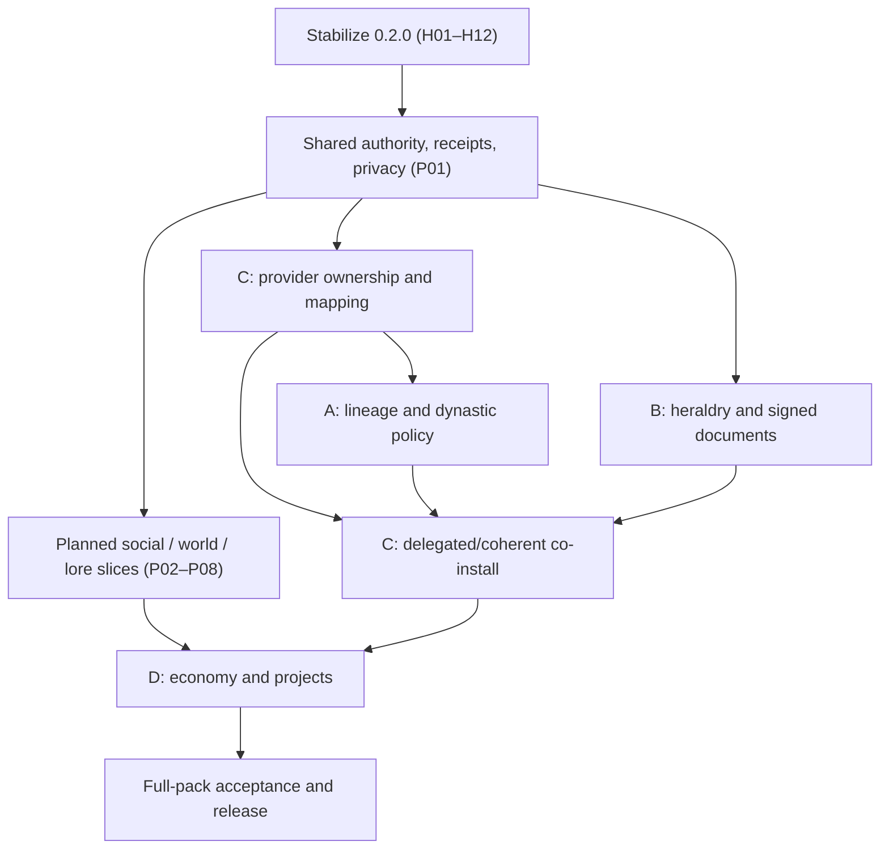

# MCA: Kingdoms — Comprehensive Audit and Implementation Handoff

**Audit date:** 2026-10-27  
**Repository:** https://github.com/otectus/MCAKingdoms  
**Inspected baseline:** `main` at `01f8d14a0eece06c8c06f9d2bf2b814d244c5506` (0.2.0 unreleased)  
**Target platform:** Minecraft 1.20.1, Forge 47.4.23, Java 17  
**Assignment:** Fix confirmed defects, close verifiable incompleteness, finish compatible previously planned work, then deliver the four expressly approved feature areas. **This is an implementation specification, not evidence that changes have been coded, tested, or released.**

> **Product decisions confirmed by Jade:** APPROVED — **A: expanded dynastic monarchy; B: physical kingdom identity; C: comprehensive MCA Capitals co-install integration; D: opt-in autonomous settlement development and economy.** NOT APPROVED — **E: NeoForge 1.21.1 port.** Do not start E. The four approvals supersede older exclusions *only where those exclusions directly conflict with A–D*. All safety, player-consent, authority, and other-mod ownership rules remain in force.

## 0. Agent operating instructions and definition of done

1. **Audit the current checkout again before editing.** Pin its SHA, inspect dirty/untracked work and reconcile this document against changes since `01f8d14`. Preserve unrelated work. Review `README.md`, `CURSEFORGE.md`, `CHANGELOG.md`, `REVIEW.md`, `MODMAP.md`, the U/UX audits, `docs/R1-*.md` through `docs/R4-*.md`, `docs/politics/*`, `docs/MCAKingdoms-Capitals-Inspired-Implementation-Guide.md`, `docs/MCAKingdoms-Factions-Integration-Audit-and-Roadmap.md`, and the actual source/tests.
2. **Use existing services.** Do not rewrite settlement detection, replace government storage, recreate R1–R4, install another GUI framework, or silently introduce parallel faction/quest/reputation/crime/worker systems. Changes must be incremental, server-authoritative, saved-data-safe, and compatible with existing IDs and APIs.
3. **Distinguish evidence levels:** `CONFIRMED` = observed in source/docs; `REGRESSION-TO-REPRODUCE` = documented failure not yet traced to runtime; `RISK/INVESTIGATE` = suspicious code requiring a proof/benchmark; `PLANNED` = already in project roadmap; `APPROVED-NEW` = A–D only. Never label a plausible risk a verified gameplay defect.
4. **Implement in reviewable vertical slices**, each with migration, tests, docs, screenshots where visual, and a player-visible loop. Do not land one monolithic PR. Fail closed when a companion capability is unavailable. Do not change sibling repositories, a real user's saves, deployed pack, or live server settings without separate permission.
5. **Ship server authority and safety before cosmetics or simulation.** Authorization, stale revision handling, request replay protection, idempotent receipts, privacy-aware snapshots, bounded CPU/network/disk behavior, and clean optional-mod lifecycle are release gates.
6. **For every write that crosses mod ownership:** document (i) owner, (ii) precondition/evidence, (iii) actor and permissions, (iv) commit/receipt, (v) restart recovery, (vi) missing-provider fallback, (vii) visible user explanation. If any is absent, mark the action `UNAVAILABLE` in UI and do not perform it.
7. **No silent data loss or coercion.** Do not force MCA relationship or surname changes, transfer children or villagers, confiscate goods, repurpose player inventories, autoload arbitrary chunks, or overwrite Townstead/MineColonies-managed buildings. Political roles remain separate from professions.

### 0.1 Preserve the actual 0.2.0 baseline

The current tree already contains approximately **342 production Java files**, **59 unit-test classes**, **22 GameTest Java files**, **125 JSON resources**, complete `en_us`/`es_es`/`zh_cn` catalog key parity, and the following major implemented systems:

- Stable kingdom/settlement identity, existing-world village recognition, split-village reconciliation, aliases/redirects, residence/founding, saved-data rename migration.
- R1 civic network; R2 institutions, commissions, charters, government offices and agreements; R3 Recruits-based warfare, controller/sovereign separation, civilian contracts and mobilization; R4 opt-in evolving-world events, elections/regency, organizational lifecycle, MCA family introductions and negotiated recruit transfer.
- MCA Reborn, Townstead, MCA Quests, MCA Reputation, MCA Crime and Recruits integrations, each within existing contractual limits.
- Redesigned manuscript-style **Book of Kingdoms, Village Ledger, Kingdom Tasks, Guilds, Government, War Room and Settings**, with 70 guide topics, live recipe diagrams, typed guide schema v2, task search and prerequisites, contextual help, keyboard navigation, narrator text and localized screens.
- Existing public `api` facades, datapack reload/validation, rate-limited and viewer-filtered network endpoints, test harnesses and sample addon/datapack material.

**Do not re-implement completed U1–U11 or UX-01–UX-12 tasks** merely because their original plan checkboxes are stale. Validate their behavior, then address the explicit remaining gaps below. The prior `docs/MCAKingdoms-Audit.md` and `REVIEW.md` high-severity remediation items are marked closed in the repository; reopen only on a newly reproduced regression. There are no currently open GitHub issues/PRs in the inspected snapshot and no `TODO`, `FIXME`, `XXX`, `HACK` or `TBD` markers in production Java. That is not evidence of zero bugs.

### 0.2 Severity and work ledger

| ID | Priority | Evidence status | Finding and affected areas |
| --- | --- | --- | --- |
| H01 | P0 | REGRESSION-TO-REPRODUCE | Packaged R3 test intermittently fails to record a native Recruits siege; apparent test-fixture config watcher race. `tools/test/integration_runtime.py`, `tools/test/runtime/java/.../WarfareScenario.java`. |
| H02 | P1 | CONFIRMED | Elected-leader office-removal preflight can disagree with the authoritative operation. `politics/GovernmentService.java`. |
| H03 | P1 | CONFIRMED | Multiple player/operator service outcomes are literal English and some expose raw unit UUIDs. `evolution/*Service.java`, `warfare/*Service.java`. |
| H04 | P1 | CONFIRMED | Tests rely on developer-specific absolute paths; no checked-in GitHub Actions workflows in snapshot. `tools/test/*`, `tools/client-test/*`, `.github/workflows/`. |
| H05 | P1 | CONFIRMED validation gap | Narrator audio, unusual GUI scale/fonts/resources, two-server reconnect, complete MCA/Townstead client, live negotiated Recruits transfers not all manually verified. `docs/Usability-Implementation-Record.md`, `docs/MCAKingdoms-GUI-Audit.md`. |
| H06 | P1 | RISK/INVESTIGATE | Persistence helpers disagree on behavior when `ATOMIC_MOVE` is unsupported: one fails; another falls back to ordinary replace. `persistence/AtomicSavedDataWriter.java` vs `factions/DurableSavedDataIO.java`. |
| H07 | P1 | RISK/INVESTIGATE | Recruits durability confirmation flushes all loaded entity storage plus synchronous I/O; possible server-tick stalls at scale. `compat/recruits/RecruitsTransfer.java`. |
| H08 | P2 | RISK/INVESTIGATE | `PoliticalNetwork.bounded` strips fields but may not enforce a hard final 60 KiB serialized-result ceiling for worst-case header/text combinations. |
| H09 | P2 | CONFIRMED | Legacy `ultima_kingdoms` advancement/stat/recipe progress does not migrate; namespace compatibility has a one-release removal TODO. `persistence/LegacyRename`, `MODMAP.md`. |
| H10 | P2 | CONFIRMED | Static book/media guide schema supports images, but no bundled guide topic uses an `image` block. Optional map/schematic, JEI/REI handoff, history filters and personal objective pin are documented outstanding enhancements. |
| H11 | P2 | CONFIRMED | `SettlementKnowledge.search` caps consideration at 20,000 recognized settlements without exposing an informative completeness state. |
| H12 | P2 | CONFIRMED | `kingdomGating.cacheBySettlementRevision` and `settlementReassignmentPolicy` are documented reserved/no-op config options; stale audit checkboxes and `MODMAP.md` generated heuristics can mislead. |
| H13 | P1–P2 | PLANNED | Previously planned faction API, context/privacy, concrete social/quest/law/trade/world integrations, events, maps, datapack tooling and player-facing stories remain to be reconciled with existing R1–R4 implementations. |
| A | P1–P2 | APPROVED-NEW | Automatic, rule-bound dynasty/house/succession/title/legitimacy/mourning features, layered on current government. |
| B | P1–P2 | APPROVED-NEW | Placeable heraldry, banners, royal seals, charters, court objects, accessible physical identity. |
| C | P1–P2 | APPROVED-NEW | Comprehensive co-install interoperability with MCA Capitals, with exactly one authoritative owner for each overlapping domain. |
| D | P2–P3 | APPROVED-NEW | Opt-in settlement economy/development and actual visible progression, with safe Townstead/building, inventories, world edits and tick budgets. |

## 1. Mandatory stabilization and defects

### H01 — Deterministically fix the R3 siege acceptance fixture

**Evidence.** `MODMAP.md` documents an intermittent failure at “saved native siege appears in history.” `WarfareScenario.run()` calls `WarfareConfig.MILITARY.set(false)` during the scenario and later toggles it back. Forge's file-watcher reload can change the cached config value; when native Recruits receives the siege start without a defender/campaign, the event may be canceled. This is a **moderate-confidence fixture-race diagnosis**, not a verified production-siege bug.

**Implement:**

1. In `tools/test/integration_runtime.py`, configure `[political_warfare] militaryActions = false` in the R3 fixture's server-side TOML *before launching the server*. Verify the actual Forge TOML key/section by reading `WarfareConfig` and the generated file; do not assume spelling from this instruction alone.
2. Remove all in-scenario `ConfigValue.set` mutations. Make `WarfareScenario` assert the native Recruits `isUnderSiege`/saved claim immediately after `setUnderSiege(true)`, then separately assert Kingdoms persisted/replayed one transition.
3. Add timing/log breadcrumbs: phase, Forge config value and source, native return/state, exact claim identity, Recruits event outcome, Kingdoms event receipt. Distinguish event cancellation, failed persistence, and projection lag.
4. Run the packaged R3 acceptance **at least 20 clean fixture boots**, rotating temp directories where possible; assert zero nondeterministic outcomes. If it still flakes, instrument the native Recruits event bridge and fix the actual cause; do not suppress the assertion or add arbitrary sleeps.
5. Add the regression reason to `MODMAP.md` and close only after logs demonstrate stability.

**Acceptance:** immediate native siege state observed; exactly one history/control fact persists after restart; tests pass with military actions both disabled (fixture) and enabled (explicit authorized campaign), including absent/offline defender branches.

### H02 — Make government action availability agree with actual mutation

**Evidence.** `GovernmentService.actionDenials` currently special-cases `REMOVE_OFFICE` when the elected leader is present **and there is exactly one office**; the actual mutation includes a stronger elected-leader protection. A multi-office constitution can appear to permit removing the elected leader, then reject on submission.

**Implement:**

- Centralize a pure authorization/eligibility evaluator, e.g. `GovernmentActionPolicy.evaluate(actor, government, action, target, revision)`, used by both server mutation and server-generated task/form previews.
- Preflight must be **target-specific** for `REMOVE_OFFICE`, and explain the current elected mandate even when other offices exist.
- Ensure `ABDICATE`, successor naming, regency, delegated office revocation and Capitals ownership use the same eligibility source; redact private identity as required.
- Return a stable semantic denial key plus bounded arguments, not an authoritative action flag from the client.
- Tests: elected leader with 1/2/5 offices; removing a normal minister; leader self-abdication; office holder NPC/player; government revision races; unauthorized viewer; `mcacapitals` present.

**Acceptance:** a client never sees an action enabled on the basis of generic preflight when the selected target is prohibited; the authoritative mutation still rechecks all rules.

### H03 — Complete localization and player-facing output normalization

**Evidence.** Book/screen language catalogs have matching keys, but backend results remain English in `RecruitTransferService`, `EvolutionService`, `ProtectionService`, `CampaignService`, `MobilizationService` and `evolution/drama/DramaService`. Mobilization messages sometimes display raw entity UUIDs.

**Implement:**

1. Audit **all outward text boundaries** (commands, packets, action responses, logs presented through screens, gamerule/config diagnostics, tooltips, generated history and error handling) across these packages. Distinguish a true UI string from internal structured diagnostics.
2. Replace outward string messages with semantic result codes and typed parameters, rendered as `Component.translatable` or a versioned translation-key DTO. Do not blindly replace every Java string; preserve log/internal IDs separately.
3. Use human-readable unit/person/kingdom labels in the UI, with short disambiguation where needed. Full UUIDs belong only in opt-in copy/debug information visible to authorized operators.
4. Add identical keys and placeholder semantics to `src/main/resources/assets/mcakingdoms/lang/{en_us,es_es,zh_cn}.json`; avoid machine-esque technical jargon and grammatical string concatenation.
5. Validate line length, formatting placeholders, narration text and error recovery for all bundled locales. Ensure fallback to a useful English explanation if a third-party translation is absent.
6. Keep wire codecs backward-safe within versioning policy; if payload shape changes, bump affected channel versions and document compatibility.

**Acceptance:** all user-triggered success/refusal/pending paths work in English, Spanish and Chinese; no untranslated UUID-heavy messages by default; logs still expose actionable IDs to admins.

### H04 — Portable, reproducible test tooling and CI

**Evidence.** Current scripts name paths like `/home/otectus/Projects/.mcmod-tools/gradlew-quiet.sh`, a sibling MCA Crime EULA, an absolute CurseForge instance and a bespoke `/tmp/kd-xvfb` binary. No workflow files were found under `.github/workflows`.

**Implement:**

- Default to repository-local `./gradlew`, with optional environment/CLI override for a quiet wrapper. Support paths with spaces and Windows path separators where scripts claim cross-platform support.
- Replace implicit jar/EULA/config paths with documented `--minecraft-instance`, `--mods-dir`, `--recruits-jar`, `--eula-file` or task-scoped environment variables. **Do not copy an EULA from another project**; require an explicit acceptance step for temporary server harnesses.
- Separate fast unit/schema/API checks from GameTests, packaged dedicated-server matrix, real-pack multiplayer/client probes and visual QA. When a required external jar/graphics capability is absent, emit `SKIPPED: reason`, never claim `PASSED`.
- Add CI for `./gradlew --no-daemon test`, clean compile/build, `verify_artifacts.py`, resource/lang/JSON/datapack schema validation, provider-free public API smoke compilation and a basic dedicated-server dist smoke when fixtures permit. Use caches without shipping test-only artifacts.
- Pin and record exact Minecraft, Forge, MCA, Townstead, Crime, Quests, Reputation, Conversations, Recruits and Capitals versions/hashes in an optional locked integration manifest; only mark certified tuples as tested. Do not require proprietary or local modpacks in public CI.
- Normalize script exit codes, fail on unavailable required dependency in release mode, write log/manifest artifacts on failure, and ensure no side effects escape a uniquely created test run directory.
- Document a one-command local quick check and a separately invoked full-pack acceptance suite.

**Acceptance:** a clean runner with only Java 17, Python and checked-in Gradle wrapper can execute core checks; supported packaged suites run with explicit artifacts; no source needs developer-specific absolute paths.

### H05 — Finish real usability/accessibility and multiplayer validation

Use `docs/Usability-Implementation-Record.md` and `docs/MCAKingdoms-GUI-Audit.md` as the baseline; their remaining items are **validation gaps**, not necessarily broken features.

- Run an accessibility matrix: 1280×800 at scale 2/3 (previous evidence), 1920×1080 and 2560×1440 at scale 1/4, minimum practical width, alternate resource pack/font, high-contrast and pseudo-locale; test keyboard-only, Tab order, slider controls, scrollbar drag, modal focus restore, item tooltip overlap, narrator actual audio (e.g. working system TTS), and resize while the form is open.
- Test 70 guide topics, every actual `GuideRecipe` display, dynamic recipe sync with datapack overrides, image fallback, contents/bookmarks/favourites and screen narration. Validate documented `BookIllustrations` and manuscript layout rather than replacing them.
- Test `MCA + Townstead` with real Blueprint headers and arrival banners, first arrival after join/dimension change, genuine NPC talk and building recognition.
- Test two clients with separate discovery and office permissions; disconnect, change server, reconnect; verify that client `ClientState` remains local, while no server-specific private or stale packet survives.
- Test a full Recruits campaign and a negotiated two-party transfer in the exact supported jar version, including restart while awaiting consent, refusal, chunk unload and owner disappearance.
- Conduct at least **five new-player sessions**: discover existing village, understand kingdom/settlement identity, use Book, found or join where authorized, complete one commission and locate the help for a refused action. Record friction and remedy confirmed findings.

**Acceptance:** a dated test matrix with actual screenshots/video/logs and tester observations. Don't mark unexecuted cases passed.

### H06 — Unify save failure and atomicity policy

**Investigate before patching.** `AtomicSavedDataWriter` uses `ATOMIC_MOVE` with replacement; `DurableSavedDataIO` silently falls back to non-atomic replacement on `AtomicMoveNotSupportedException`. One policy may be deliberately stricter for higher-value state.

- Inventory all custom save writers/readers, backup/journal uses, forward-schema guards and corruption recovery paths; include organizations, political records, evolution, recruitment, warfare and new A–D state.
- Specify per-store durability contract: staged temp file, fsync where feasible, `ATOMIC_MOVE` support, backup generation and restore, precise error state and read-only refusal on unknown future schema.
- Do **not** globally allow unsafe fallback simply for uniformity. If atomic rename is unsupported, prefer preserving last good data plus actionable admin warning; if a fallback is proven safe enough for a limited store, document its narrower guarantee.
- Inject failures after temp write, before rename, during index receipt commit, corrupt/truncated read and schema-forward load. Verify no previous valid save is destroyed and no acknowledged operation is repeated after restart.
- Avoid cross-mod distributed-transaction claims; use existing durable outbox/receipt semantics.

**Acceptance:** consistent, documented guarantees, no silent corruption, no backward schema wipe, controlled state when disk/filesystem cannot uphold its required guarantee.

### H07 — Profile and bound Recruits durability verification

**Risk, not yet measured.** `RecruitsTransfer.saveAndConfirm` calls broad `PersistentEntitySectionManager.saveAll()`, overworld `DataStorage.save()`, and synchronous `IOWorker.synchronize(true).join()`/`loadAsync(...).join()` on the server thread.

1. Add instrumentation for entity count, loaded chunks, flush duration, server tick p50/p95/p99, pending transfer and I/O queue sizes under representative 1-, 5-, 20- and 100-unit transfers on an active server. Record exact Recruits 1.15.2 behavior.
2. Research whether the validated Recruits/Forge 1.20.1 APIs permit targeted entity/owner/account writes, explicit provider receipts, or a recoverable deferred confirmation without forcing global entity saves. Prefer a narrow ack protocol to an immediate full world flush **only if** crash-safety remains demonstrable.
3. Preserve explicit consent, ownership provenance, no chunk loading, prepared/committed state and proof that the transferred entity remains durably owned by the new party across crash/restart.
4. If strict synchronous durability cannot be achieved within server budgets, split request into durable `PENDING_NATIVE_SAVE` and eventual verification, with bounded scheduler, timeout, `REQUIRES_OPERATOR_REVIEW` state and cancel/repair affordances. Do not tell the player a transfer completed prematurely.
5. Add large-world performance/restart tests and admin visibility of queues.

**Acceptance:** same-or-stronger transfer safety, measured elimination or bounded cost of global flush, no tick stall/regression hidden behind renamed code.

### H08 — Validate hard network payload caps

Fuzz `PoliticalNetwork.bounded` and all paginated responses with maximal permitted translated titles, organization names, history entries, large authorization diagnostics and adversarial combinations. Check both **serialized bytes** and rendered line counts after all truncation layers; if >60 KiB remains possible, apply deterministic final packing and explicit “more results” indicators. Preserve Unicode code points, never leak hidden fields through size/continuation metadata, and reject oversized input before allocation. Tests should include malformed packet, wrong protocol, replay, request flood and huge but valid authorized history.

### H09 — Complete rename retirement without breaking old worlds

- `MODMAP.md` tracks “Remove one-release `ultima_kingdoms` compatibility (here and companions).” First identify the **real released version boundary**, published companion dependencies and actual upgraded-save population; do not infer the grace period from unreleased `0.2.0` or simply delete support.
- Keep the one-time **on-disk conversion path** needed to load legacy `ultima_kingdoms_*.dat` and old config names on future worlds. Deprecating old *runtime aliases* is distinct from removing migration.
- Test upgrade matrix: fresh `mcakingdoms`; 0.1.0 Ultima world; mixed older Quests/Conversations/Reputation/Crime; partially completed rename; legacy definitions or commands; absent companion; removed/reinstalled mod.
- Decide whether advancement, recipe-book and statistics migration is safely possible per Minecraft identity storage. Implement **opt-in, idempotent** progress migration if safe and demonstrably worthwhile; otherwise document the one-time unlock behavior (already known) without corrupting vanilla player data.
- If ready, remove temporary legacy API aliases and old companion mod IDs **in coordinated companion updates only**. Maintain aliases in data migration; historical provider patches stay archived.

### H10 — Close the explicitly deferred UX improvements (bounded scope)

These items are **already suggested/planned**, not newly approved systems:

- **Book diagrams:** add well-authored `image` block content to key chapters (government chain, map/discovery, diplomacy, warfare, commissions, perhaps historical heraldry) using schema v2. Always supply narrated descriptive text, scale variants and fallback. Reuse the visual guide, live recipes and asset-source policy; do not replace functional ingredient/recipe widgets with screenshots.
- **JEI/REI recipe handoff:** conditional “View recipe in recipe browser” when an installed provider exposes a supported API, with the built-in recipe view remaining complete offline. Treat JEI/REI support as optional compatibility.
- **Discovered places:** a bounded, authorized settlement/kingdom schematic or map link; share exact positions only when `SettlementKnowledge` says the viewer may know them. Map Atlases first where companion integration exists; JourneyMap/Xaero only with probed APIs, not hard dependencies.
- **History navigation:** filter by event type, kingdom, date and visibility on the authorized fact snapshot; optional lightweight timeline. Keep pages server-bounded and do not resync the entire event log.
- **Objective pin:** client-local pin of one currently available task with progress, unobtrusive HUD/ledger location, keyboard/narrator text and stale/unavailable cleanup. It never authorizes action completion or changes server quest ownership.
- Resolve any verified onboarding copy, unclear “kingdom vs village,” unavailable feature or recovery-message friction from H05. Keep bundled English/Spanish/Chinese parity.

### H11–H12 — Search completeness, config truth and documentation hygiene

- `SettlementKnowledge.search` explicitly evaluates at most 20,000 recognized settlements. Decide from profiling whether to implement paged indexed search, a larger configurable cap or a clear “results may be incomplete” state with resume cursor. Never claim a world-wide exhaustive search beyond the scanned cap. Keep viewer authorization applied **before** projection and result count.
- `kingdomGating.cacheBySettlementRevision` and `settlementReassignmentPolicy` are currently documented as **reserved/no-op**. Either remove from visible config while preserving parse compatibility, label them clearly nonfunctional, or implement the intended behavior **only after documenting exact semantics and tests**. Never start using legacy saved values as active policy without migration/consent.
- Update `MODMAP.md` hand-written “uncommitted” wording after current `01f8d14`, rerun its generator, annotate known false heuristics (existing mixins; multilingual resources) and avoid hand-editing AUTO blocks.
- Mark completed original plan boxes with links to actual code/evidence, keeping remaining tasks open. Align `README.md`, `CURSEFORGE.md`, `CHANGELOG.md`, `docs/Configuration.md`, public API, recipes, guide and `mods.toml` version/dependency statements. Never ship a giant unreleased changelog as proof of validated gameplay.


## 2. Previously planned capability roadmap — reconcile, then finish

**Critical:** `docs/MCAKingdoms-Factions-Integration-Audit-and-Roadmap.md` predates the completed R1–R4 deliveries and is partly a design inventory, not a list of missing classes. The coding agent must build a **source-backed delta ledger** for every existing roadmap ID (`A01...`, `B01...`, `S01...`, `R01...`, `Q01...`, `L01...`, `E01...`, `X01...`, `D01...`, `API01...`), classifying each as `implemented and verified`, `implemented but untested`, `partially implemented`, `blocked by provider`, `unimplemented` or `no longer desirable`. Cite method/test paths. Do this **before** creating new faction tables or combat code.

### 2.1 Capability owners — enforce these boundaries across every phase

| Domain | Canonical owner | What MCA: Kingdoms owns / adds | Never duplicate |
| --- | --- | --- | --- |
| Settlement ID, identity, kingdom mapping, aliases, discovery | MCA: Kingdoms existing `core`/`settlement`/`knowledge` | Stable references, recognition/authority, viewer-scoped political projection, nation-level identities | Another village detector, re-identifying saves on chunk reload, forced retro-generation |
| Player/NPC identity, kinship, marriages, life stages | MCA Reborn; relevant Townstead capabilities | Dynastic claims derived from verified relationships; political records only | MCA person UUIDs, genetics, marriages, professions, schedules, age and health |
| Institutions, roles, constitutions, office, petitions, agreements | Kingdoms `politics`, `civic`, `factions.organization`; or Capitals when present | Consistent policy, contracts, charters, ceremonies, A/B expansions | Two simultaneous sovereign writers or two elected-mandate stores |
| Social opinions | MCA Reputation + MCA Reborn where supported | Institutional/political effects with receipts and explanation | A second personal hearts system or unbounded score mirroring |
| Crime and legal enforcement | MCA Crime / existing guard owners | Legal/jurisdiction **policy** and provider-confirmed service restrictions | Independent warrants, prisons, confiscation, enforcement AI |
| Workstations, town production and civic buildings | MCA/Townstead, or explicitly selected building provider | Institution references, funded projects, D economy adapter and safe optional improvements | Replacing Townstead scheduling/needs/Blueprint recognition |
| Military units, siege/claims, combat | Recruits 1.15.2 validated provider | Treaty/permission/control context, civilian services, native action receipts | Second unit AI, owner spoofing, independent PvP/claim capture |
| Quest objectives, rewards and delivery | MCA Quests / verified quest provider | Author missions, restrict/offer through provider interfaces, consume deduped completion receipts | Side quest progress counters or self-awarded item turn-ins |
| Currency and player goods | Verified wallet/trade/inventory provider | Terms, quotes, demand, project funding and transactional state **after** owner acknowledgment | Double currency conversion, silent inventory scanning or independent balances |
| World maps/travel | Map Atlases, Waystones, optional installed map providers | Discovered/authorized waypoints, political metadata and marker overlays | Broadcasting hidden coordinates, teleport rewrite |
| Public narrative and NPC conversations | MCA Conversations, Townstead Chronicles when available | Structured political facts, role-aware dialogue predicates, filtered histories | Overwriting dialogue packs or simulating private gossip globally |
| MCA Capitals co-install | Capitals for domains it owns; explicit C bridge for mappings | Coherent combined UI, delegation, read-through state, compatibility and scoped Kingdoms-only additions | Concurrent mutations, bidirectional automatic overwrite, copied licensed code |

### 2.2 Existing roadmap work packages

**P01 — Shared faction ontology, receipts and permissions (foundation).**  
Reconcile `api/factions/*`, `api/factions/organization/*`, `factions/FactionsRuntime`, `factions/organization/*`, `api/politics/*` and `api/worldcontext/*` with Phase 0/1 of the older roadmap. Add only missing typed concepts: stable identity and alias, institution/sovereign relations, membership/obligation and lifecycle; political/legal/trade/military/recognition/knowledge **facets**; availability; authenticated actor/scoped action; distinct claimant/controller/recognized-sovereign; visibility; deterministic per-recipient event/outbox receipts. Preserve public API binary compatibility. Use immutable, provider-free DTOs, capability/health reporting, idempotency and versioned snapshots; never put provider implementation objects into the API jar. Keep a single source of truth for each stored value.

**P02 — Tangible peaceful institution and social loops (high priority).**  
Build from existing guild/commission/standing systems and the documented Phase 2 “Lamplighters” pilot: a discovered workshop or road survey leads to a provider-verified Quests objective, civic evidence, a **single** institutional Reputation consequence, a distinct rank/access change, an MCA Conversations explanation and a useful service in a neighboring settlement. Add 10–12 carefully chosen existing quest/content templates, **without resetting quest IDs** or generating redundant quests. A peaceful independent player must complete the loop without joining a kingdom army. Make favor versus local dislike visible, respect personal/public knowledge and avoid speaking for an absent NPC. Keep all sibling-mod changes as separate explicitly scoped PRs.

**P03 — Institutional law, mediation, restitution and protected civilians.**  
Extend the already present `compat/crime/InstitutionalCrimeBridge` and `JurisdictionPolicyBridge` only through verified MCA Crime APIs. A provable reported theft or other committed crime can suspend a *specific* guild service, then provider-confirmed restitution/appeal restores it; unknown/unreported accusations cannot magically become kingdom-wide fact. Display which court and institution owns each consequence. Support treaty-conditioned hospitality, noncombatant protection and extradition **only if** Crime exposes a safe authorization/receipt path; otherwise leave legal enforcement unavailable with explanation. Cover masks/uncertain attribution, corrected evidence, peaceful neutrality and no family reputation erasure.

**P04 — Agreements with real effects and provider-owned economics.**  
Tie `GovernmentService` treaties, `api/politics/AgreementClauseView` and civilian contracts to verifiable outcomes: safe-conduct, institutional access, commissions, relief exemptions, mutually acknowledged trade and restitution. Later implement pre-commit quotes, tariffs, embargoes and optional dues only after a tested economy provider; this overlaps approved D below, so **one common economy service**, not separate P04 and D stacks. Never stack provider and Kingdoms discounts recursively. Canonicalize bilateral treaty keys and explicitly model expiry, suspension, revision and signatory authority.

**P05 — Exploration, routes, regions and settlement context.**  
Build on `knowledge/SettlementKnowledge`, `worldcontext/*`, `warfare/ControlState` and existing MCA/Townstead structure recognition. Add authorized map pins/survey intelligence, meaningful border/controller/sovereign context, political places based on discovered structure IDs/tags, trade/relief routes and optional ruins/expedition contracts. Read Recruits claims rather than seizing them; keep culture, original residence and citizen families intact during occupation. No chunk-generation-thread lookup of mutable political state, no automatic mass scans, no disclosure by guessed settlement UUID.

**P06 — Magic, religion, race, culture and lore gates (only documented/verified integrations).**  
Follow roadmap `M01–M05` and `docs/mcakingdoms.md`: introduce optional institution qualifications and dialog/contract content based on *existing* Runic Skills, Runic Races, Runic Gods, spell systems, RPG Lore, Tinkers/Jewelry and pack tags. An institution may recognize an earned credential or a verified rune/ritual/archival discovery; it must not rewrite spellbooks, mana, genetic race, deity allegiance or a player's eligibility to play normally. Keep religion/race alternatives that allow other paths; never make protected heritage a mandatory requirement for peaceful advancement. Verify actual public APIs and pack mod IDs before implementing optional adapters.

**P07 — Bounded emergent politics and stories.**  
Extend `evolution/*` and `evolution/drama/*` rather than adding another director. Prioritize treaty proposals, guild shortages, research/artisan requests, civic recognition, succession disputes, autonomy negotiations, peaceful relief and memorials. Advanced rebellion, coup, civil war, occupation response, sanction circumvention and destroyed-faction recovery remain **separately gated authored scenarios** with opt-in, visible causal history, player action and reversible resolutions. Strict per-region queues/budgets, deterministic saved deadlines and source receipts; unloaded people are not declared dead. A dormant world must not simulate destruction while no one is present.

**P08 — Datapack and third-party authoring.**  
Use actual definition loaders and `examples/datapack`/`examples/addon`. Fill missing self-contained examples: a nonmilitary cultural institution; rank/obligation; qualification with an alternate route; public/private dialogue fact; contract and owner receipt; political event; visual heraldry definition; A dynasty law; D development profile; C mapping (operator configuration, not public data). Publish schemas and server-side commands (`validate`, `reload`, `diagnose`, `explain`) with staged **atomic generation swaps** or domain-local keep-last-good as current reload contract requires. Test invalid references, cycles, duplicate IDs, unavailable optional providers, unknown definition versions and removed datapacks. Keep `api` jar provider-free.

### 2.3 Prioritized playable acceptance slices for P01–P08

1. **Artisan:** craft real goods → verified commission → distinct guild standing → a service/introduction across a border; one receipt, one award, clean decline/refund.
2. **Neutral traveler:** discover a safe route → get a privacy-safe diplomatic warning → use safe-conduct or a neutral alternative; another client receives no hidden waypoint.
3. **Accused villager/resident:** reported case → source-attributed institution denial → restitution/appeal in MCA Crime → access restored, without generic moralizing or rewriting individual opinions.
4. **Scholar/faithful explorer:** actual lore/ritual research → college/temple recognition → research commission; nonmember gets a fair alternate route.
5. **Defender/mercenary:** native Recruits siege → one verified control transition → civilian protection/peace outcome → explicit demobilization, no owner theft.
6. **Diplomat:** existing office authorization → treaty signature → actual provider-confirmed access/commission → expiry/revoke/restart cleanup.
7. **Defeated faction:** lifecycle change → saved institutional history/people retain identity → optional recovery/amnesty contract, not entity deletion.

A feature is **not complete** simply because its API returns a value. At least one of these player loops must use it from start to finish with comprehensible UI, refusal path and restart test.

## 3. APPROVED A — Expanded dynastic monarchy, nobles, succession and mourning

**Design intent:** extend the existing, optional Kingdoms political layer into a believable dynasty and court system, *without* rewriting MCA's people or forcing royal status onto elected republics. This supersedes the earlier narrow `docs/MCAKingdoms-Capitals-Inspired-Implementation-Guide.md` exclusions of automated dynastic succession and expanded houses. Its rules are overridden by C when Capitals is the canonical owner.

### A1 — Discover verified lineage and build political house records

- Add isolated `politics/dynasty/` service interfaces/classes (proposed names: `DynastyService`, `DynastySavedData`, `LineageAdapter`, `SuccessionPolicy`, `SuccessionResolution`, `DynasticEvent`). Extend `McaFamilyEvidence` and Townstead life-stage capability probes; use official MCA person/relationship IDs, **never** world/entity display names as identity.
- Distinguish canonical `PersonRef` (player or NPC), `HouseId`, `DynastyId`, lineage *evidence source*, relation type, effective validity interval, claimant eligibility and visibility. House membership and noble rank are **political facts**; parenthood/marriage/adoption remain read-only MCA-provided facts.
- Support biological/adoptive parentage, spouses, stepfamily and guardians, multiple marriages, same-sex partners, player/NPC rulers, missing MCA capabilities and unloaded people. Define exactly which edges count for succession under a data-driven law. No assumptions about genetic relation, gender, name, living state or adult status from a UUID alone.
- Maintain lineage **references plus evidence receipts**, not a second copy of MCA's complete genealogy. If a relationship becomes unknown after mod removal, mark it unresolved and freeze dependent automatic actions until reconciled.
- Reuse `PoliticalSavedData` government and current `house` metadata where suitable. If a new `DynastySavedData` store is justified, reference existing government IDs and do not fork throne/office records. All migrations are idempotent, incremental and forward-schema guarded.

### A2 — Constitutions, claimants, heirs and succession

- Provide per-government configurable inheritance law: `MANUAL_ONLY` (existing behavior), `DESIGNATED_HEIR_THEN_LINEAGE`, `EQUAL_PRIMOGENITURE`, `ELECTIVE_MONARCHY`, `COUNCIL_CONFIRMATION` and `CUSTOM_DATAPACK` as supported stages; introduce only rules that can be proven deterministic with available identity/evidence. **Default existing worlds to `MANUAL_ONLY`** until admin/ruler opts in.
- Each candidate has visible **explanations**: relationship proof, age/life-stage gate, living-state confidence, current office/conflicts, renunciation/acceptance, law priority, support/legitimacy and authority source. Provide deterministic tie-breaks and stable sorting, no arbitrary random kings.
- Lifecycle: `ACTIVE_RULER → VACANCY_CONFIRMED → INTERREGNUM → CLAIMS_PENDING / REGENCY → RATIFIED_SUCCESSION → ACTIVE_RULER`; explicit `BLOCKED_NEEDS_REVIEW` on conflicting or incomplete evidence. Distinguish verified death from unloaded/dimension-travel/not-observed. Preserve existing `GovernmentService` elections and regency logic; elected offices must never be auto-replaced by hereditary policy.
- For a minor heir, create a temporary bounded regency mandate issued through the existing office/delegation system, governed by the server's verified age policy. On adulthood or ratification, retire the mandate once. Require a legitimate confirmation/acceptance path where the constitution demands one.
- Allow clear renounce/contest/legitimize/pardon claim actions subject to ruler/council/operator policy, with immutable provenance, appeals and cooldowns. A legal challenge can change priority **only** after explicit authority/receipt; gameplay drama cannot secretly force a coup.
- On death/abdication/offline transition, emit **one** political fact and schedule a deterministic resolution, with idempotent request IDs, expected revisions and restart replay. Test races: two heirs, two clients, multiple deaths on one tick, adoption after designation, lost MCA link, elected leader, ruler removal, merged settlement, Capitals dual-owner.
- User-facing Book chapter and Kingdom screen: ancestry summary (privacy-aware), house crest, eligibility list, “why this heir,” law preview, regency countdown, secure confirmation, pending/blocked state and accessible narration.

### A3 — Noble ranks, houses, legitimacy and court functions

- Define a **data-driven hierarchy** of rank/title and forms of address (e.g. sovereign/consort/heir/duke/count/baron/court function), with per-kingdom constitution and culture localization; do **not** impose real-world English-only titles on Serenum, Lunari or other kingdoms. Distinguish ceremonial styles, landless ranks, elected offices, honorary awards and actual delegated permissions.
- Reuse the existing government `Office`, `HOUSE` action, civic honors and `OrganizationMembershipSnapshot`. A `TitleGrant` should reference grantor/recipient, authority, scope, rank, expiry, revocation, source and historical status; it must not bypass office authority or grant Recruits/Crime privileges by item or title alone.
- Legitimacy is an **explainable political claim assessment** derived from bounded facts such as lineage validity, succession law, confirmed mandate/recognition and sanctioned governance acts. Do not introduce an unbounded global reputation score or let a fabricated rumor dethrone a ruler. Provide configurable weight definitions and deterministic recomputation on fact change.
- Court appointments remain secondary to MCA jobs/Townstead schedules and do not change NPC role AI. Optional audience dialogue uses MCA Conversations public hooks when available; fallback via existing Kingdoms screens. Emblems and charters are provided by B.
- Add petition/acknowledgment options for title grants, honorable resignation, renunciation, appeals and inter-house mediation. No forced marriages, arranged betrothals, surnames or NPC relocations.

### A4 — Ceremonies, memorials and mourning

- On verified ruler death/abdication, publish one bounded public memorial/chronicle entry plus a clear court-status transition and optional scheduled funeral/audience contract; use existing `PoliticalFact` and `evolution/drama`. Private death/evidence should respect viewer permissions.
- Support **optional reversible mourning livery**, visual banners or court-decoration changes and herald announcements via verified MCA/Townstead-supported cosmetic capabilities. Snapshot prior appearance with provenance, apply only to opt-in eligible participants, restore exactly when term ends or capability disappears. If no supported visual hook exists, render mourning in UI/overlays only.
- No forced grieving/mood simulation or mass edits of villagers' clothes; no artificial announcement on world load/restart. Rate-limit repeated ceremonies and include server/client mute controls.

### A5 — Required A tests

- Pure tests of lineage graphs (loops/corrupt parent edge, twins/tie breaks, adoptive links, same-sex couples, unknown/deceased/unloaded, king without children, player heir, ruler in another dimension, elected republic).
- Constitutional law tests with old `PoliticalSavedData` fixtures, permitted/forbidden transitions and resource/data reload.
- GameTests for NPC death/abdication, regency adulthood, law change, claim reversal, lost MCA/Townstead provider, multi-client competing claims, privacy and restart.
- Full-pack client walkthrough: found kingdom → grant court rank → inspect family tree → name heir → ruler death → controlled interregnum → consent/confirmation → proper successor → memorial; no ghost office or duplicate notices.
- MCA Capitals active: do **not** run native A succession writer if C selected Capitals as owner; read/delegate and explain availability.

## 4. APPROVED B — Physical heraldry, banners, seals, charters and courts

**Design intent:** make current flags/kingdom names/constitutions visible in the actual world and actionable as **verified documents**, while using the existing `client/book/` manuscript design and item/recipe conventions.

### B1 — Content architecture and authored assets

- Expand `item/ModItems.java` and a dedicated `registry`/`block` package as needed, with stable `mcakingdoms:` IDs and data-generated (or validated hand-authored) item models, blockstates, loot, recipes, tags, subtitles, creative-tab placement and en/es/zh strings. Existing Book/Ledger items and IDs must not move.
- Ship a small coherent set first: **Kingdom Banner/Standard** (placeable, dye/pattern aware), **Heraldic Shield or Crest Display**, **Royal Seal / Seal Press**, **Kingdom Charter** (physical book/document), **Court Sign / Noticeboard**, and **Council Table / Audience Lectern** as appropriate. Limit decorative proliferation; make each object serve one useful function.
- Prefer using vanilla banner designs and forge-supported dynamic tint/pattern data where possible, with B resource assets for unique motifs. Consistent with Kingdoms' parchment/ink/leather visual identity. Provide colorblind-safe names, labels, icons and shape/pattern differentiation independent of color.
- Build one server-authoritative `HeraldryDefinition` per stable kingdom ID: primary/secondary palette, palette-independent shape/sigil, motto, provenance and revision, optional historical variants for regime changes. Support datapack overrides with validation and owner-chosen changes. Do not distribute arbitrary texture files from client messages.

### B2 — Legitimate charters, seals and roles

- Make charters/seals **proof of a specific committed transaction**, not a magic admin key. A crafted blank charter may open a petition, but only the server-issued, signed `DocumentRecord` (ID, issuer, kingdom/settlement, scope, subject, issued/revoked state, revision, receipt) has legal meaning.
- An item carries a reference and sanitized presentation; the server looks it up in a durable ledger and revalidates current permissions, signature/receipt and expiry on every action. Duplicating an item must not duplicate titles, grants, founding events, payments or offices. Item NBT alone cannot authorize administration.
- Provide useful documents: founding/capital designation, office appointment, treaty offer/ratification, noble title grant and public proclamation. Physical documents can be held, inspected, traded or displayed, but any authority-bearing act still requires authenticated actor/policy and target context.
- Clear workflows: craft blank parchment/seal materials → visit correct office/table → preview law/revision/prerequisites → authorized sign → receive commemorative physical artifact and committed fact → recipient inspect/accept/decline if required → revoke/expire with historical visibility.
- Maintain a non-item UI fallback (existing Book/Ledger/commands) for lost document, accessibility, absence of crafting materials and disabled physical-content configuration; no irreversible administrative lockout.

### B3 — World placement, rights and performance

- Resolve any placed heraldic block to a stable kingdom ID and optional settlement alias at placement; store only bounded immutable render hints, not complete private government state. If the kingdom dissolves or is renamed, show historical crest with appropriate status and a safe rebinding/admin tool.
- Respect vanilla/pack claims and protection hooks, item use distances and permissions, dedicated-server side separation, WorldEdit/structure copying and silk touch/loot behavior. **Decorative possession never creates land claims or forced government control.**
- Prevent hostile spoofing of “official” status: an unverified copy may be decorated but must not visually impersonate a signed charter in an authoritative UI; tooltips clearly distinguish `Official / Unverified / Revoked`.
- Cache atlas/pattern rendering by definition revision with hard bounds, invalidation on reload/world change and safe fallback for missing assets. No unbounded texture generation per kingdom name, packet spam or chunk scanning.
- Placeable official banner and charter content must stay sensible when MCA Capitals is installed: delegate crown seals to C if Capitals owns them; Kingdoms-only guild/civic banners remain independent.

### B4 — Required B tests

- Registries/models/loot/recipe/lang consistency; multi-pattern banners; dye variation and visually distinct motifs; JEI/recipe fallback.
- Invalid, forged, duplicated, expired and revoked charter; two signers at once; bearer without permission; wrong kingdom/dimension; legacy save migration; missing assets.
- Client GUI scales, narrator descriptions, block interaction/raytrace, shader/resource-pack compatibility and texture-memory/tick-budget profiling.
- Server restart, world copy, settlement merge, kingdom rename/retirement, mod removal/reinstall, optional decoration disabled; no phantom claim/control or orphaned item crash.


## 5. APPROVED C — Complete MCA Capitals co-install interoperability

**Baseline defect of completeness (intentional design, not a crash):** `GovernmentService` sets a `mcacapitals` conflict flag when MCA Capitals is loaded; native Kingdoms governmental mutation requests reject and its government pages become historical/read-only. That protects saves but does **not** deliver an integrated player experience. The approved goal is **coherent operation of both mods together without duplicate sovereign truth**, not running two competing government systems at once.

**Peer reference:** [MCA Capitals official repository](https://github.com/MajesttyX/mca_capitals_addon), including inspected Forge 1.3.8 branch/source; [CurseForge MCA Capitals](https://www.curseforge.com/minecraft/mc-mods/mca-capitals). Verify **actual published Forge 1.20.1 artifacts, loader/MCA versions and public APIs** before coding. The two source trees have different license terms (Capitals source identified as GPL-3; Kingdoms is marked All Rights Reserved): **do not copy or transpose Capitals code, textures, sounds or authored content**. Implement original, contractual interop, with upstream permission/API cooperation if necessary.

### C1 — An explicit ownership/capability negotiation layer

Create `compat/capitals/` with proposed contracts:

- `CapitalsCapabilities` — installed, supported version, available read/write/event facets, diagnostic and provider revision.
- `SovereignAuthorityResolver` — authoritative provider **per kingdom and per domain**, not merely a global “Capitals installed” boolean.
- `CapitalIdentityBinding` — canonical Kingdoms settlement/kingdom ID ↔ verified Capitals capital, sovereign/court/house IDs and provider epoch/revision; admin-confirmed if ambiguous.
- `CapitalsReadBridge` — immutable normalized read projections; `CapitalsActionBridge` — only verified public delegated mutations/receipts; `CapitalsEventBridge` — idempotent committed fact subscription with correction/tombstone handling.
- `CapitalsReconciliationService` — dry-run diffs, ambiguity/overlap quarantine, policy selection, resumable rollback-safe transitions and operator diagnostics.

**Determine and document owners explicitly:**

| Overlap | Co-install preferred owner | Kingdoms behavior |
| --- | --- | --- |
| Village/settlement canonical identity and aliases | Existing Kingdoms civic identity; actual MCA villagers from MCA | Map Capitals capital to proven settlement(s) without rewriting civic UUIDs or claiming every capital equals a kingdom. |
| Royal founder, crown office, noble ranks, house/dynasty, succession | Capitals when it exposes authoritative records | Read/delegate to Capitals; suppress native A writer for same monarchy; optional Kingdoms-only honors/secondary institutions remain separate. |
| Capital seat and formal government | Chosen authoritative mode; default Capitals-primary for mapped capitals | Show one canonical capital/ruler, merge only viewer-authorized context; no second founding/abdication. |
| Kingdoms constitutional offices, guilds and civic commissions absent from Capitals | Kingdoms | Continue working; elected/republic government rules never silently replaced by Capitals monarchy. |
| Petitions, decrees, treaties, diplomatic state | Per operation and verified provider capability | Delegate overlapping sovereign decree/treaty when Capitals owns it; keep non-overlapping Kingdoms civic contracts. Show provenance and separate clauses. |
| Military campaigns, war state and claim control | Recruits for native unit/siege/claim; Capitals for its own crown war authorization if it governs | Avoid duplicate declaration/war reward; maintain recognized sovereign vs military controller, consume provider receipts. |
| MCA identity/family and NPC death | MCA | Derive verified facts once; Capitals/Kingdoms each consume only where responsible. |
| Currency, inventory, penalties and economic effects | Their existing provider | Never replay a Capitals treasury/payment/justice action as a Kingdoms payment/Crime charge. |
| History/announcements | Source owner publishes; Kingdoms may retain filtered projection | One event ID/provenance/visibility, no double herald broadcast or double faction-standing effect. |

### C2 — Compatibility modes and safety

**Required modes (world/server configuration, opt-in per binding as needed):**

1. `KINGDOMS_ONLY` — Capitals absent or no overlap: existing native Kingdoms politics is authoritative; A/B/D work normally.
2. `CAPITALS_PRIMARY` — **default for successfully mapped Capitals capitals**: Capitals owns sovereign/dynastic/court processes. Kingdoms provides a unified Book/Ledger read-through, Guilds/Factions, authorized settlement data, native civic agreements where distinct and B/D where not conflicting. Mutations are delegated **only through a verified stable Capitals operation API**.
3. `KINGDOMS_PRIMARY` — allow only when Capitals supplies an explicit *read/observer or delegation* mode that prevents its own competing writes. Never force this by monkeypatching private fields.
4. `UNMAPPED_OR_UNSUPPORTED` — safe read-only diagnostic for overlapping actions, with Kingdoms' unrelated functions still active. No invented fallback monarch, automatic import or silent deletion.

**Important feasibility gate:** If the current Capitals build provides **no safe public mutation/event interface**, comprehensive *read-only coexistence* can be delivered independently, but **full delegated two-way functionality requires an upstream API patch/coordination or an explicitly reviewed, version-locked adapter with provably safe supported hooks**. Do not market unsupported mutation as complete, use fragile reflective private-field writes or bypass its permission checks. Produce a narrow upstream API proposal with method/event signatures, receipt semantics and tests as a blocking deliverable.

### C3 — Precise mapping, reconciliation and migration

- Inspect upstream capitals from actual loaded/saved owner APIs; discover all capital(s)/realm(s) in the same world. Never equate capital coordinates alone to a Kingdoms record. Map by strong evidence: stable provider ID → verified dimension and structure/settlement reference → operator confirmation for ambiguity; store provenance, revision and aliases. Prohibit a silent N:1 or 1:N merge.
- Display a **dry-run compatibility report**: Kingdoms polity, Capitals capital, current holder, office conflicts, family conflict, duplicate treaties, war divergence, unresolved references, proposed owner, and actions that would become read-only/delegated. Allow authorized override with audit log and rollback.
- Legacy Kingdoms governments retain **historical save records**, and relevant fact histories remain accessible, when Capitals becomes primary. Do not erase, auto-transfer or re-create offices. Resume Kingdoms primary only by deliberate reviewed transition and replay/snapshot reconciliation.
- Rebind after settlement split/merge, capital move, kingdom rename, ruler death, data reload, server restart, provider load/unload and player reconnect. Do not assume a runtime mod can be unloaded without a server restart; handle removal across server boots safely.
- Normalize visible status: “Managed by MCA Capitals,” “Managed by Kingdoms,” “Not synchronized,” “Awaiting permission” and “Unsupported Capitals version.” Every Book/Tasks/Kingdom action should explain its owner and link to the appropriate UI or delegated operation.
- Respect exact visibility for private family ties, legal accusations, diplomatic secrets and undiscovered locations. Do not ship hidden Capitals save records in an overbroad Kingdoms client packet.

### C4 — Integrate A, B, D without double writes

- **A:** map royal houses/claimants/title/legitimacy fields to Capitals' verified semantic surfaces. Disable duplicate automatic succession for Capitals-managed monarchies; allow Kingdoms-specific honors only as clearly distinct secondary roles. Check late death/abdication ordering and reentrancy.
- **B:** Kingdom banners and heraldic objects can display official Capitals-owned crown heraldry when authoritative identity is available, and clearly distinguish player-crafted visual copies. A charter from Capitals must be inspected/validated through its owner, not forged by a Kingdoms NBT signature.
- **D:** preserve the Capitals owner of any capital treasury/trade shipment/economy hook. Kingdoms may fund civic development through separate contracts, but require quote/receipt and resource owner selection before any cross-service effect.
- **Existing R1–R4:** Factions, Quests, Reputation, Crime, Recruits, Townstead and War Room continue working with mapped Capitals capital context. No reward from one military event may be awarded a second time via two government bridges.

### C5 — Required C tests

- Cross-product matrix: Kingdoms alone; Capitals alone (upstream sanity); both fresh; both with preexisting Kingdoms government; both with preexisting Capitals crown; worlds with mutually conflicting founding; moved capital; kingdom split/merge; provider upgraded/removed/reinstalled.
- Probe exact compatible Capitals 1.20.1 Forge jars and MCA version, including optional companion tuples. Reject unsupported tuples with diagnostics, **not** `NoClassDefFoundError` on the dedicated server.
- Same-tick MCA death, Capitals succession and Kingdoms regency; replayed sovereign event; two players sign identical treaty; Capitals war versus Recruits siege; simultaneous B charter issuance; Townstead election and Capitals crown authority.
- Record count assertions: **one** sovereign owner per mapped domain, one effective title/succession transition, one monetary mutation, one history announcement, one claim-control receipt; no leaked private data or stuck pending writes.
- Dedicated-server and two-client full packaged suite, live UI read-through and delegated action when supported. Test missing upstream write hook as a **clear unsupported** branch, not silently “passing.”

## 6. APPROVED D — Opt-in autonomous settlement economy and development

**Design intent:** settlements can prosper, stagnate, recover, specialize and develop visibly in response to real activity, governance and trade, with **bounded, inspectable autonomy**. This approval permits limited autonomous economic/development simulation that older roadmap documents excluded, but it does **not** authorize changing MCA/Townstead needs/jobs, manipulating players' inventories, bulldozing structures or inventing inaccessible resources.

**Inspiration only:** [MineColonies](https://minecolonies.com/) (builder requests, explicit jobs/projects, city management, citizen feedback), [official MineColonies Wiki](https://wiki.minecolonies.ldtteam.com/) and [Millénaire](https://millenaire.org/) (settlement cultures, trade and visible growth). Do not copy their code/assets or require their mechanics. Optional interoperability with these mods is attempted **only for an actual compatible target build/capability**, not promised merely from conceptual similarity.

### D1 — Choose safe operating modes

Create `economy/` and `development/` packages or extend `evolution/` where conceptually correct; reuse the current once-per-region budgeted scheduler and saved-data/event architecture.

| Mode | Initial default | Behavior |
| --- | --- | --- |
| `OFF` | **Default for all existing and new worlds** | Existing 0.2.0 gameplay unchanged; no D saves/projects/world edits. |
| `OBSERVE` | Optional | Read verified Townstead/MCA economy/buildings and produce development/need explanations only; never debit, build or trade. |
| `PROJECTS` | Opt-in per world | Post player-facing public construction/procurement contracts; consume verified deliveries/contributions and unlock project milestones; no unattended block placement. |
| `MANAGED_GROWTH` | Explicit server and per-settlement opt-in | Plan and execute approved/autonomous improvements only within safe designated territory and strict change budgets. |
| `FULL_ECONOMY` | Separate opt-in *after* contract testing | Supply/demand, funded production abstractions, civic treasury/project reserves and trade routes; optional verified provider economic effects. No global price rewrite. |

The admin may pause economy and construction independently, opt settlements in/out, select cultural themes, budgets, protected zones and level of automation. Turning a mode off preserves state but stops pending work safely; re-enabling resumes with review. No auto-activation on upgrade. Existing `EvolutionConfig` is not a substitute for separate D consent.

### D2 — Source-of-truth economy model, not a second hidden item world

Propose compact `SettlementEconomyState` keyed to **canonical settlement ID** (resolved through aliases), with development tier, provenance/confidence, specialization, approved public demand, project reserves, optional abstract commodity balances and last bounded processed tick. All stocks must be marked as one of:

- `PHYSICAL_VERIFIED` — actual provider-owned inventory/production with a versioned read or committed transaction receipt;
- `ABSTRACT_SIMULATED` — D's deliberately virtual economy ledger for policy/supply planning; **never** assert the corresponding Minecraft items physically exist;
- `AUTHORED_DEMAND` — a quest/project request rather than measured shortage.

Maintain commodity **tags**, recipes/substitutions, seasonal preference where a verified calendar exists, structure/workshop evidence, production limits, queue size, decay/expiry and anti-farm caps. Avoid separate fake villager hunger/mood, globally scanning chests or spawning goods from abstract reserves.

- Producers/crafters/jobs: Townstead or MCA owns real worker routines, schedules and inventory. D may read verified output/capabilities or simulate **aggregate** abstract capacity when explicitly enabled, but cannot order loaded NPCs around without a supported owner task interface.
- Players: participating through real deliveries, funded commissions and projects. An accepted delivery consumes items **through MCA Quests or another server-authoritative transaction hook**, exactly once, with inventory rollback/refund on failure; no arbitrary crafting-action reward farming.
- Currency: detect real provider channel and quote semantics (possibly Dot Coin or documented vanilla emeralds). Never create a second currency balance or infer wallet semantics from presence of an item. Where no safe wallet provider exists, disable monetary debit/credit and use item-backed or zero-payment public projects with honest UI.
- Civic treasury, voluntary project contributions, and previously planned **negotiated** dues/tariffs, if enabled, are **real transactional records** with escrow/receipts and spending authorization, not passive infinite income. **Periodic automatic taxation is not approved by A–D; do not implement it without a separate product decision**, even if a payment provider could support it. There is no default player tax, global embargo or hidden inventory extraction.

### D3 — Development planning and visible safe construction

- Represent each prospective improvement as `DevelopmentProject`: settlement ID/revision, template/role (road, noticeboard, lighting, workshop upgrade, market stall, wall segment, garden, civic hall), local footprint, provider/claim checks, materials/budget, approved builder policy, blockers, rollback journal and state machine.
- Project lifecycle: `PROPOSED → SURVEYED → APPROVED → FUNDED → READY → BUILDING → COMPLETED`; explicit `BLOCKED`, `PAUSED`, `CANCELLED`, `REPAIR_NEEDED` transitions. Save reason codes, world/pack revision and actor/source evidence. Never leap from “funded” to “built” simply because a chunk was unavailable.
- **Placement safety is non-negotiable:** loaded chunks only; world-border/dimension allowlists; check vanilla/protection/claim hooks; choose unoccupied/approved locations; deny player-owned containers, beds, farmland, redstone, tile entities and named structures; honor Townstead Blueprint and MineColonies managed regions, existing village buildings, roads/doors/POI access and protected historic sites. A screenshot/blueprint match is not consent.
- Prefer already recognized Townstead construction/project hooks (if public APIs are available). If no provider can build, implement a **small vanilla-safe structure-template path** restricted to designated opt-in civic plots. Perform planning against immutable snapshots; world mutations on the server thread in bounded block batches. Journal before/after for each planned block so a partial failure can be paused/inspected and (where safe) rolled back without destroying intervening player edits.
- Style profiles reflect existing cultural/biome palettes and datapack definitions; require material substitutions/accessible alternatives. A settlement must not rebuild already upgraded sites after chunk unload or create duplicate POIs every revisit.
- Growth tiers must reflect **verified** completed projects, infrastructure and real provider evidence; do not inflate tiers based only on player login or arbitrary elapsed wall time. Display “planning,” “construction pending materials,” “blocked by protected land,” and “finished” honestly.

### D4 — Trade, routes, hazards and inter-settlement effects

- Treat trade links as bilateral contracts between known/authorized settlements, subject to actual diplomacy, reputation where provider-owned and valid path/waypoint evidence. Use existing `CivilianContractService` and political agreement clauses rather than duplicating treaty writers.
- At baseline, run **abstract, explicitly labeled scheduled trade** with capped virtual commodity transfers only between `ABSTRACT_SIMULATED` ledgers. No real chest items are removed or fabricated, and no player currency is paid without confirmed service. Link progress to actual player-facing supply/escort/negotiation contracts where available.
- Physical caravans or transport NPCs only through an actual supported entity/mount/provider API, **only while relevant chunks are ordinarily loaded**, with bounded entity count, pathfinding tickets and behavior cancellation; no permanent chunk loaders. Persistence records must distinguish pending dispatch, in transit, delivered and failed. Never grant both virtual and physical rewards for the same cargo.
- Optional risk events (blocked bridge, dangerous route, pirate/bandit threat, weather closure, damaged market) require an observed encounter or clearly authored scenario, not fabricated NPC fatalities. Provide peaceful relief/safe-route choices, protection for neutral trade and reversible responses to embargoes.
- War/control changes can limit *authorized institutions and contracts*; they cannot silently seize citizens, personal storage, Lootr containers, farmer inventories or another mod's settlement.

### D5 — UI, culture, agency and observability

- Add a manuscript-style **Development and Economy** tab to the Ledger/Kingdom screens with development stage, demand provenance, available materials, project visual preview, projected site footprint, owner/approval, treasury/quote source, route status and reasons for every blocked action. Keep it usable at narrow GUI scales, with keyboard/narration and all three locales.
- The player can accept/sponsor/deliver to projects and petition their rulers; office holders/admins can review, schedule, change budget, veto, pause and recover construction. Ordinary residents can opt out of affecting player property; no plot placement outside designated safe areas.
- Integrate D status into Book recipes, contextual tasks, voluntary guild commissions, political history and optional map markers. Explain what actually changed in the world and who authorized it.
- Give admins `/kingdoms development inspect|pause|resume|dryrun|repair|export` and `/kingdoms economy inspect|diagnose|reconcile`-style functions (fit existing command tree), with paginated, redacted diagnostic output. Include tps/queue/backpressure counters and state export for safe incident investigation.

### D6 — Performance, offline simulation, recovery

- Tick work only on bounded intervals and eligible **loaded/active** settlements, with per-dimension region budgets, maximum projects/routes, CPU time budget, block edit cap, pathfinding/entity cap, packet size cap and shutdown drain policy. Do not scan every village in every dimension on each tick.
- Default `offlineProgress = false`. If separately enabled later, cap catch-up by server game time and perform only *abstract* reversible operations; do not place blocks, kill NPCs or consume real inventories from an unloaded area.
- Data schema/version and transactional recovery: no double demand/stock credit; one verified delivery cannot finish several unrelated projects; no duplicate construction on restart; no block edits after permissions revoked; no corrupted save on disk failure; no irreversible terrain action during unsupported provider state.
- Provide per-world backup advice and operator **dry-run first**. If a mod/provider is removed, pause affected projects, retain ledger IDs for reconciliation, and remain loadable in safe read-only mode. Do not delete political state.

### D7 — Required D tests

- Unit: resource conservation across ledgers, demand caps, recipe substitution, prosperity/tier consistency, no negative/overflow inventories, repeat delivery and concurrent quote revisions, no payment without ack.
- GameTest: vanilla-only settlement old/new, Townstead active, mature built village, player claim, adjacent container/bed/path/POI, forbidden dimension, split/merge identity, chunk unload mid-construction, missing template, pack reload, site ownership change, admin pause, crash after each project state transition.
- Full-pack: linked settlements with 2 clients; one protects a private house, the other sponsors a civic project; real Quest item removal/receipt, actual built marker, visible ledger update, safe abort/restart and route/siege interactions.
- Performance: at least 10/50/200 identified settlements (including many unloaded), 1/10/50 concurrent projects, active Recruits siege plus two clients; measure p95/p99 main-thread tick, chunk loads, entities/tickets, queues, network bytes and disk flush; compare OFF/OBSERVE/PROJECTS/MANAGED_GROWTH. Set budgets from measured data, not intuition.

## 7. MCA Capitals and similar mods — feature comparison / reuse decisions

| Feature/capability | MCA Capitals | MineColonies | Millénaire | MCA: Kingdoms baseline → approved direction |
| --- | --- | --- | --- | --- |
| Ruler, court, dynasty, noble succession | Dedicated monarchy/court services | Settlement administration, not necessarily MCA genealogy | Village leaders/cultural systems | Government/offices/regency already exist; **A** adds lineage-rich monarchy; **C** defers overlap to Capitals. |
| Heraldry, royal charters, physical court identity | Royal/political ceremonies and identities | Town Hall and physical management blocks | Culturally styled buildings | Current Book/Ledger and identities exist; **B** adds placeable verified world objects. |
| Diplomacy, chronicles, petitions | Extensive royal narrative/diplomacy | Colonies/alliances/relations | Inter-village relationships | R2 diplomacy/petitions and R4 history exist; deepen operational effects and preserve owner. |
| Town growth and worker-driven building | Not the primary focus of government compatibility | Structured builder/job/work request and town growth loops | Cultures and expanding villages | Townstead/MCA buildings owned by providers; **D** adds optional project/development orchestration with safe bounded world edits. |
| Trading, shipments and supplies | Kingdom-level trade services | Resource requests and economic logistics | Village trade and goods | Existing commissions/civilian contracts; **D** optional verified economy and route layer, no duplicate physical stocks. |
| Military and conflict | Crown-led political/military elements | Colony defense within its own systems | Village raids/diplomacy | Kingdoms R3 uses **Recruits** as native military owner; retain this even with A/C/D. |
| Guided user experience | Capital-specific controls | Purpose-built management screens | NPC and village interactions | 0.2.0 manuscript Book/Ledger/Tasks already strong; add explanations/visibility rather than a second UI framework. |
| Optional install and pack compatibility | MCA-specific add-on | Separate ecosystem/dependencies | Different era/platform support | Verify **exact same-platform binaries** before offering adapters. Similarity is an inspiration, not evidence of runtime compatibility. |

**Comparison conclusion:** borrow **design principles**, not code or entire gameplay loops: visible construction requests and explainable resource needs; recognizable, culturally styled landmarks; NPC-supported civic work; institution-aware diplomacy and royal ceremonies. Keep Kingdoms' distinctive strength: **one cross-mod political context and identity layer** that can coexist with MCA/Townstead/Recruits/Crime/Quests, plus opt-in A–D features.


## 8. Cross-cutting implementation architecture

### 8.1 Proposed modules and integration seams

The names below are **proposals**, not claims that these classes already exist. Reuse the current code wherever an equivalent implementation is present.

| Layer | Existing touch points | Proposed additive work |
| --- | --- | --- |
| Civic core | `core/KingdomsServiceImpl`, `core/SettlementSavedData`, `settlement/*`, `api/KingdomsService` | Stable identity references, remapping subscriptions; do not rewrite identity model. |
| Politics | `politics/GovernmentService`, `PoliticalSavedData`, `PoliticalDefinitions`, `PoliticalNetwork`, `api/politics/*` | Shared action policy, constitutional law/dynastic queries, source-authorized delegation and bounded page projections. |
| A dynasty | `compat/mca/McaFamilyEvidence`, `evolution/EvolutionService`, `evolution/drama/*` | New `politics/dynasty/*` with policy, lineage evidence and state, no parallel office table. |
| B content | `item/ModItems`, `client/book/*`, `guide/KingdomGuide`, `src/main/resources/*` | `heraldry/*`, `document/*`, new blocks/items/renderers/data definitions, charter ledger. |
| C bridge | `politics/GovernmentService` conflict paths and `politics/PoliticalProviderVersions` | `compat/capitals/*` capabilities, identity/authority resolution, adapter, event receipt, reconciliation. |
| D economy | `evolution/EvolutionRuntime`, `factions/organization/*`, `warfare/contracts/*`, `compat/townstead/*` | `economy/*` stock/source/quote/route, `development/*` project/builder state; one scheduler/owner policy. |
| Other mods | `compat/quests/*`, `compat/crime/*`, `compat/recruits/*`, `compat/reputation/*`, `api/townstead/*` | Upgrade existing bridges only through verified provider APIs and exact version/capability probes. |
| GUI | `network/NetworkHandler`, `client/book/*`, `client/rich/*`, `interaction/*`, `client/politics/KingdomScreen` | Consistent manuscripts, source-aware results, per-viewer filtered A–D pages and authorized task links. |
| Datapacks | `data/*`, `guide/*`, `PoliticalDefinitions`, `EvolutionDefinitions`, `examples/datapack` | Typed definition schemas, validation, transactional reload, explicit migration. |

### 8.2 Versioned contracts and saved data

- Maintain the existing **provider-free public API jar** and public method compatibility. Introduce opt-in v2 interfaces/DTOs for new capabilities instead of changing return types consumed by installed companion mods. Advertise capability IDs and revisions; clients must not send invented `PersonRef` authority, completion receipts or prices.
- Keep Forge SimpleChannel protocol discipline: baseline main protocol 6, task/interaction 4, civic 4, politics 4 and War Room 4 in the inspected snapshot. **Bump only channels whose wire schemas change**, update exact server/client compatibility checks, reject stale/malformed/oversized/replayed requests, and test mixed-version handshake rejection with actionable messaging.
- Define **one canonical semantic operation envelope** where cross-mod effects occur: unique request/causation ID; authenticated actor; target and expected revision; owner provider/version; source event proof; operation type; scope; bounded payload; visibility; terms hash; idempotency key and deadline. Each recipient effect uses a deterministic sub-ID `(cause, recipient, operation)`.
- A multi-provider action follows `PREPARED → OWNER_ACCEPTED → EFFECT_RECORDED → COMPLETE`, plus explicit `REFUSED`, `PENDING_PROVIDER`, `NEEDS_RECONCILIATION` and `COMPENSATED_WHEN_SAFE`. Do **not** pretend atomic commit across mods. Persist the next effect before acknowledging it and requery existing native provider receipts on startup.
- Use overworld `SavedData` for cross-dimension state and carefully scoped per-world config; do not attach enormous lineage/economy graphs to every villager's entity NBT. Namespaced stable keys, alias resolution and schema version are mandatory. Unknown future schema = read-only with diagnostics, never reset.
- New schema families should use independent gates: `dynastyEnabled`, `physicalHeraldryEnabled`, `capitalsInteropMode` and `developmentMode`. Make defaults safe; existing-world migration is not an implicit request to activate simulation.
- Avoid hidden whole-world scans. For every retained cache/queue define capacity, TTL/revision invalidation, unload/shutdown cleanup and a warning threshold. All mutations and UI permission projection occur server-side, on the correct main-thread context; async workers operate on immutable snapshots only.
- Data reload must follow the existing `ReloadReport` policy: validate independent domains and preserve last known good generation when domain-local failures are allowed; reject an entire generation where linked definitions could otherwise become half-valid. Show the accepted/rejected generation in admin Health/Reload and never clear live definitions first.

### 8.3 Example data schemas (proposal only)

These examples are **design targets**. An agent must pick repository-consistent resource locations and publish accurate schema docs/tests before distributing them as loadable datapack examples.

```json
{
  "schema": 1,
  "id": "mcakingdoms:serenum_heraldry",
  "kingdom": "mcakingdoms:serenum",
  "primary_color": "#315544",
  "secondary_color": "#E7D4A6",
  "pattern": "mcakingdoms:oak_crown",
  "motto_translation_key": "heraldry.mcakingdoms.serenum.motto",
  "variant": "ordinary"
}
```

```json
{
  "schema": 1,
  "id": "mcakingdoms:hereditary_council",
  "allowed_government_profiles": ["mcakingdoms:monarchy"],
  "succession": "designated_then_lineage",
  "kinship_sources": ["mca_verified"],
  "eligible_life_stages": ["adult"],
  "adopted_heirs_eligible": true,
  "regency": "existing_mandate",
  "confirmation": "council",
  "tie_break": "stable_person_id"
}
```

```json
{
  "schema": 1,
  "id": "mcakingdoms:road_and_market",
  "culture_tags": ["mcakingdoms:public_works"],
  "opt_in_mode": "projects",
  "demand": ["#c:stone", "#c:wooden_slabs"],
  "structure_role": "market_noticeboard",
  "verified_delivery_required": true,
  "auto_build_allowed": false,
  "max_blocks_per_tick": 0
}
```

**Schema rules:** stable namespaced IDs; allowlists for selectors, dimensions and structures; tagged item inputs/known recipes; no arbitrary Java class, command execution, external URL fetch or file paths from datapacks; bounded strings/list lengths; explicit owner/provenance and availability; secure references to existing political authority. Sample values are illustrative and do **not** assume that `mcakingdoms:monarchy` or `#c:stone` already exists in the installed definitions.

### 8.4 Integration capability checks, not version-string optimism

At startup, log an ordered provider matrix with mod ID, actual version, tested tuple, available capabilities, enabled effects, owner, and diagnostics. Relevant minimum reported dependencies from inspected `mods.toml`/repository are:

| Component | Inspected expectation | Rule for agent |
| --- | --- | --- |
| Minecraft / Forge | 1.20.1 / 47.4.23 | Compile and run on actual Forge 47 runtime; no NeoForge implementation in this assignment. |
| Java | 17 | Use supported bytecode/APIs. |
| MCA Reborn | exact development/runtime validated around 7.6.26; metadata range `[7.6,8)` | Probe actual methods/owners, not just version range. |
| Townstead | declared optional around `[0.7.6,0.9)` | Existing capability-based fallback takes precedence over superficial version match. |
| MCA Quests | optional `[1.6.5,)` | Verify institutional completion-consumer and reward lifecycle; no self-signed receipts. |
| MCA Reputation | optional `[0.6.0,)` | Keep local opinions and sovereign/institutional standing distinct. |
| MCA Crime | optional `[0.7.5,)` | Verify legal policy/query hook and attribution before service consequences. |
| Recruits | integration validated **exact 1.15.2** | Do not assume `[1.15.2,)` metadata means future jars preserve reflection/native storage layouts. |
| MCA Conversations | optional companion | Use public integration contracts; no global dialogue replacement. |
| MCA Capitals | `mcacapitals` detection currently conflicts | Validate a concrete Forge 1.20.1 co-install jar and ideally upstream stable adapter contract. |
| MineColonies/Millénaire | comparator only unless compatible provider verified | Inspiration does not equal existing support or dependency. |

### 8.5 Privacy, authority and consent invariants

Every domain must enforce:

1. **Viewer-scoped data:** undiscovered settlement coordinates, private kinship/evidence, personal standing, Crime case witnesses, confidential treaties, trade reserves, unit ownership and crown legitimacy details are not sent merely because the GUI has a tab. Filter on the server before pagination and aggregation.
2. **Actor-scoped mutations:** server derives UUID/connection, current offices, building/settlement context, real inventory and native commander status. A charters' item NBT, a fake title, packet target or cached GUI denial must never be authoritative.
3. **Stable identity:** resolve merged/split villages via existing redirect resolver. Historical origin, occupation controller, claimed sovereign and current recognized polity are separate fields; their names and IDs are not overwritten by promotion or conquest.
4. **Consent and safety:** no involuntary personal/relationship changes, no auto-build on unknown/player-protected land, no charged item/currency without committed receipt, no forced chunk loads or background NPC death.
5. **Reversible off switches:** disabling A/B/C/D leaves readable saves, truthful feature diagnostics and operator reconciliation paths; absence of a dependency cannot call destructively into the last known state.

## 9. Implementation order and independent reviewable delivery cuts

Do **not** assign one version number or “complete everything in one patch.” This is a multi-release program. Suggested dependency graph:



The diagram shows **hard ownership/testing dependencies**, not a need to postpone independent B or P work while all C upstream contracts are negotiated.

| Cut | Priority | Exact deliverable | Required exit gate |
| --- | --- | --- | --- |
| S0 — Stabilization | P0/P1 | H01 fixture, H02 authority/preflight, H03 localization, H04 tests, H05 QA; resolve H06/H07 risks with evidence. | Core + packaged Recruits/MCA suites green; saved data safe; real UI QA documented. |
| S1 — Foundation/delta | P1 | Reconcile roadmaps; P01 typed authority/capability/receipts; first P02 peaceful slice; C basic read owner discovery and `UNMAPPED` safety. | No duplicate state or private data; clean no-companion boot and optional provider matrix. |
| S2 — Physical identity | P1 | B1–B4 items, banners, safe charters and court objects; Book visuals and helpful outstanding UX. | Certified asset/recipe/lang, placement/privacy/revocation and restart tests. |
| S3 — Dynastic rule | P1/P2 | A1–A5 for Kingdoms-primary governments, then C-owned query/delegation and provider gates. | Death/election/regency race tests and existing-save defaults; no surprise hereditary takeover. |
| S4 — Capitals full coexistence | P1/P2 | C1–C5 mapping/authority, read-through and verified delegated write APIs, cross-domain consistency. | Genuine two-mod packaged co-install; one sovereign owner; upstream API blockers clearly recorded. |
| S5 — Existing integration maturity | P1/P2 | P02–P08 small closed loops (Crime, Quests, diplomacy, maps, Runic/Lore, event director, datapack). | Each loop tested with source owner and includes a refusal/restart/absent-provider branch. |
| S6 — Autonomous projects | P2 | D `OBSERVE` and `PROJECTS`, vanilla/Townstead safe planning, real player-backed deliveries. | No inventory loss or world mutation outside opt-in; full migration/performance test. |
| S7 — Managed growth | P2/P3 | D `MANAGED_GROWTH`, structure-template journal, in-world improvements and rollback. | Claim/POI/protected-world safety and crash recovery independently reviewed. |
| S8 — Economy/trade | P2/P3 | D `FULL_ECONOMY`, source-labeled abstract market, verified provider quote/treasury/route features. | No dupes or virtual-to-physical fraud; scalable performance; multiplayer full-pack run. |
| S9 — Release certification | P0 gate | Updated translations, configs, docs, visuals, issue/roadmap status and certified jar test matrix. | Section 10 + 11 checks signed off with exact SHA and artifacts. |

The agent may group cleanly isolated cuts into a release but **must not** weaken the dependency gates. A blocked upstream Capitals mutation API must not force unsafe code or stop independent B/P/D work; release C as “read-only bridge / full delegation blocked” with truthful docs until verified.

### 9.1 Concrete PR/task checklist

- [ ] Establish clean pinned baseline and open **audit-delta ledger** against existing R1–R4/0.2.0.
- [ ] Fix R3 fixture and capture ≥20 stable packaged boots.
- [ ] Unify server action preflight/commit rules; add elected leader regression tests.
- [ ] Replace player-visible English strings/raw UUIDs; localize three catalogs; test actual narrator.
- [ ] Make tests portable and add CI/smoke/integration manifest; retain packaged full-mod tests.
- [ ] Resolve durable save/future-schema policy and Recruits synchronous-I/O risk with benchmarks.
- [ ] Verify payload cap, search cap, config truth, rename lifecycle and old-world fixtures.
- [ ] Complete deferred guide media, optional recipe/map adapters, history filters/task pin and genuine new-player QA.
- [ ] Fill gaps in planned faction/organization/Crime/Quests/Reputation/Conversations/Runic/World/authoring loops with source owner tests.
- [ ] Implement C capability/authority negotiations **before** overlapping A/D mutations.
- [ ] Implement B heraldry, document ledger and approved world items; test textures/recipes/rights.
- [ ] Implement A lineage, house/title, succession/regency/legitimacy, memorial and policy-controlled court.
- [ ] Implement C Capitals mapping, dry-run reconciliation, UI read-through and tested delegated operations, with upstream API blockers documented.
- [ ] Implement D opt-in development/economy progressively; no automated block edits before protected-world tests.
- [ ] Run complete release matrix, migrations, 2-client scenarios, accessibility and performance certification.
- [ ] Refresh public docs/CurseForge/Book/changelog and release checklist; produce install/upgrade/rollback notes. Do not publish without separate authorization.

## 10. Required validation matrix and evidence

### 10.1 Automated layers

| Layer | Command/action expectation | Must test |
| --- | --- | --- |
| Source formatting/build | `./gradlew --no-daemon build` (or repository-supported task) | Java 17 Forge compile, API jar, normal packaged jar, no client class eager load on dedicated server. |
| Unit/domain | `./gradlew test` | ID aliases/splits, organization membership, action denial, role/lineage law, treaty revision, receipts, volume caps, economy conservation, document verification. |
| JSON/datapack | existing real loader tests + extended invalid sample fixtures | Every JSON parses, key placeholders aligned, recipes resolve, missing tags/provider fail gracefully, atomic or per-domain keep-good reload. |
| GameTests | `tools/test/run_gametests.py` once portable | Server-authorized mutations, replay/staleness, player/child/relation lifecycle, building protection, absent provider and chunk unload. |
| Packaged dedicated server | `tools/test/integration_runtime.py` with explicit artifacts | R1–R4 + A–D save/restart, Recruits durable claims/transfer, Townstead compatibility, Capitals co-install. |
| Two-client packaged runtime | extend `tools/client-test/*` | Discovered/undiscovered viewer, opposing rulers/claimants, document spoofing, concurrent votes/purchases, UI authority, disconnect/rejoin/different server. |
| Real user and accessibility | manual test plan/screenshots | Book/Tasks/Ledger/Kingdom/Court/Development at scale/fonts, actual spoken narration, new-player comprehension. |
| Performance | profiler/recorded timings | OFF versus enabled, 10/50/200 settlements, 100 units, active war + D project, packet sizes, disk flush, queue growth and cleanup. |
| Old-world migration | immutable saved fixture copies, schema fuzz | Legacy Ultima namespace, 0.1.1/0.2.0 Kingdoms, installed/remove Capitals, A/D off/on, future schema, corrupt/truncated store. |

### 10.2 Test matrix by mod combination

Minimum supported runs, on exact jar hashes in reproducible temporary worlds:

1. Forge + Kingdoms **alone**: startup, village generation/discovery, old village recognition, Book, founding rules, no companion hard crash.
2. Kingdoms + MCA Reborn exact tested build, optionally Townstead: NPC office, family evidence, life stage and settlement footprint.
3. Kingdoms + Quests + Reputation + Conversations + Crime: actual quest item turn-in and institutional receipt, local/national standing, private/legal dialogue.
4. Kingdoms + Recruits **1.15.2**: native claim/siege, campaign, recruitment, mobilization, two-party transfer, restart.
5. Kingdoms + MCA Capitals verified Forge build: C mapping/read-only; full delegated mutation where public hook exists; A writer disabled on Capitals-owned crown.
6. Kingdoms + MCA + Townstead + Capitals + Quests + Crime + Reputation + Conversations + Recruits: at least one **end-to-end** social, warfare, dynasty/court, heraldry and development loop, two clients, 2 restarts.
7. D modes OFF / OBSERVE / PROJECTS / MANAGED_GROWTH / FULL_ECONOMY individually, with and without Townstead/transaction providers and with previously built settlements.
8. Provider upgrade/removal and invalid/missing optional APIs: no crash, no implicit state reset, unavailable actions visibly explained.

Add capability-conditional test outcomes: `PASS`, `FAIL`, `SKIP—MISSING VERIFIED PROVIDER` and `BLOCKED—UPSTREAM API`. A compile-only stub test is **not** a full-pack integration pass.

### 10.3 High-risk adversarial scenarios

- Reusing the same request UUID with different parameters; client-chosen arbitrary kingdom/settlement IDs; permission revoked while confirmation screen open; old election result submitted after ruler death; packet flood and oversized name/payload.
- Three distinct political identities: household leader, elected town leader and Recruits controller disagree; no magical identity collapse or double reward.
- Family source changes during succession: adoption, MCA marriage, death while NPC unloaded, duplicate MCA relationship event and corrupt cycle; no false “dead” state or involuntary inheritance.
- Capitals removed after a Kingdoms client cached its crown; server restart and return; no resurrection of two rulers or old cached private data.
- Charter copied, renamed, NBT-manipulated, moved to other dimension or used after revocation/kingdom dissolution; no authority bypass.
- Development plot contains player chest/redstone/bed/protected land or Townstead worksite; must refuse, not overwrite. Between survey and build, player alters land; revalidate before every batch.
- Cross-provider economy: quote accepted then treaty ends; scarce player items submitted; provider rejects; server crashes after debit but before receipt; restart exactly once, no free money or duplicate inventory removal.
- Same old village visited by two players/chunks from opposite sides; structure/POI fragments merge; political/building/economy/history references resolve through redirects without identity loss.
- Disable an A–D feature or remove dependency while work is pending; state remains durable/readable with clear repair/resume semantics and no automatic destructive cleanup.

### 10.4 Performance and data-integrity budget policy

No invented “guaranteed zero overhead” claims. Capture baseline and feature-on measurements in reproducible fixtures. Define explicit configurable hard limits for (i) work per server tick, (ii) queued project and political events per region, (iii) player-visible packet bytes, (iv) history page size and retention, (v) active route entities, (vi) block mutations per tick, (vii) amount of Recruits forced data I/O and (viii) saved lineage/economy indexes. Prefer soft budget backpressure with visible pending state over dropping committed work. Release requires no unbounded queue growth, no new forced chunk tickets, deterministic retry after crash, and acceptable p95/p99 tick delta on a representative larger save.

### 10.5 Release evidence package

For every cut, commit:

- `docs/audit-implementation-status.md` — all H/P/A–D IDs with `DONE / PARTIAL / BLOCKED / DEFERRED`, source and test references, reason, migration.
- `docs/compatibility-certified.md` — mod/loader/JDK hashes and tested/capability-limited combinations; list known unsupported releases plainly.
- `docs/testing/<release>/` (or CI artifacts linked from docs) — commands, exit codes, screenshots, videos where UI, server/client logs, sanitized config and test worlds or reproducible seed/fixture, profiler summaries.
- `docs/migration-<release>.md` — backup, upgrade, rollback/read-only recovery, Capitals ownership transitions, A–D default-off controls, legacy IDs and future-schema caveats.
- Updated `CHANGELOG.md` and player-facing `README.md`/`CURSEFORGE.md`; localized Book chapters, recipes and accessible tooltips, sample datapacks/API reference.
- Explicit unresolved issues list. A failed/blocked test remains failed/blocked; don't mask with a truncated console log.

## 11. Release acceptance checklist — absolute stop conditions

**Do not declare complete or publish a release when any of these are true:**

- [ ] Unresolved data-loss risk, duplicate irreversible payment, unsafe world edit, hidden client authority bypass or private coordinates leak.
- [ ] Existing-world upgrade changes government owner, constitutional succession law, automatic growth or tax behavior **without opt-in**.
- [ ] R3 siege fixture still intermittent, or packaged Recruits transfer leaves acknowledged ownership inconsistent after restart.
- [ ] MCA Capitals co-install has two sovereign writers for one mapped domain; if upstream delegation unavailable, claim “read-only compatibility” rather than “full feature compatibility.”
- [ ] Building engine can overwrite third-party protected blocks/POIs or load unrequested chunks, or cannot recover a partial build safely.
- [ ] Missing/unsupported optional mod crashes a dedicated server or disables unrelated Kingdoms functionality.
- [ ] Test harness only works with hardcoded personal paths, and “green” means external tests were skipped without explanation.
- [ ] User-facing outcomes lack English/Spanish/Chinese coverage or common screens become unusable at supported GUI scales.
- [ ] An A/B/C/D action has no explicit authority, evidence, idempotent receipt, failure recovery, or clear player explanation.
- [ ] Documentation treats a planned idea or source-only integration as a shipped/certified feature.
- [ ] A new unapproved feature outside A–D and previously established plans is introduced without Jade's consent. NeoForge port remains out of scope.

Successful completion means the user can install Kingdoms in an existing world, understand a recognized settlement, use civic and political services, run coexistently with supported MCA companions and Capitals, optionally build a credible dynasty, place trustworthy heraldic documents, and opt into intelligible settlement growth—**with no duplicate authority, no inventory/world damage, and observable behavior across restarts**.

## 12. Evidence/source index and audit limitations

### 12.1 Source baseline and existing documentation

- [MCA: Kingdoms — pinned audit commit](https://github.com/otectus/MCAKingdoms/commit/01f8d14a0eece06c8c06f9d2bf2b814d244c5506)
- [README.md](https://github.com/otectus/MCAKingdoms/blob/01f8d14a0eece06c8c06f9d2bf2b814d244c5506/README.md), [CHANGELOG.md](https://github.com/otectus/MCAKingdoms/blob/01f8d14a0eece06c8c06f9d2bf2b814d244c5506/CHANGELOG.md), [MODMAP.md](https://github.com/otectus/MCAKingdoms/blob/01f8d14a0eece06c8c06f9d2bf2b814d244c5506/MODMAP.md), [REVIEW.md](https://github.com/otectus/MCAKingdoms/blob/01f8d14a0eece06c8c06f9d2bf2b814d244c5506/REVIEW.md)
- [Past audit](https://github.com/otectus/MCAKingdoms/blob/01f8d14a0eece06c8c06f9d2bf2b814d244c5506/docs/MCAKingdoms-Audit.md), [GUI audit](https://github.com/otectus/MCAKingdoms/blob/01f8d14a0eece06c8c06f9d2bf2b814d244c5506/docs/MCAKingdoms-GUI-Audit.md), [player experience](https://github.com/otectus/MCAKingdoms/blob/01f8d14a0eece06c8c06f9d2bf2b814d244c5506/docs/Player-Experience-Review.md), [usability implementation record](https://github.com/otectus/MCAKingdoms/blob/01f8d14a0eece06c8c06f9d2bf2b814d244c5506/docs/Usability-Implementation-Record.md), [manuscript design](https://github.com/otectus/MCAKingdoms/blob/01f8d14a0eece06c8c06f9d2bf2b814d244c5506/docs/Book-Interface-Design.md)
- [Capitals-inspired implementation guide](https://github.com/otectus/MCAKingdoms/blob/01f8d14a0eece06c8c06f9d2bf2b814d244c5506/docs/MCAKingdoms-Capitals-Inspired-Implementation-Guide.md), [faction integration roadmap](https://github.com/otectus/MCAKingdoms/blob/01f8d14a0eece06c8c06f9d2bf2b814d244c5506/docs/MCAKingdoms-Factions-Integration-Audit-and-Roadmap.md), [R1 civic](https://github.com/otectus/MCAKingdoms/blob/01f8d14a0eece06c8c06f9d2bf2b814d244c5506/docs/R1-Civic-Foundation.md), [R2 institutions](https://github.com/otectus/MCAKingdoms/blob/01f8d14a0eece06c8c06f9d2bf2b814d244c5506/docs/R2-Institutions-and-Agreements.md), [R3 control](https://github.com/otectus/MCAKingdoms/blob/01f8d14a0eece06c8c06f9d2bf2b814d244c5506/docs/R3-Native-Control.md), [R4 evolution](https://github.com/otectus/MCAKingdoms/blob/01f8d14a0eece06c8c06f9d2bf2b814d244c5506/docs/R4-Evolving-World.md)
- [GovernmentService.java](https://github.com/otectus/MCAKingdoms/blob/01f8d14a0eece06c8c06f9d2bf2b814d244c5506/src/main/java/dev/otectus/mcakingdoms/politics/GovernmentService.java), [RecruitsTransfer.java](https://github.com/otectus/MCAKingdoms/blob/01f8d14a0eece06c8c06f9d2bf2b814d244c5506/src/main/java/dev/otectus/mcakingdoms/compat/recruits/RecruitsTransfer.java), [MobilizationService.java](https://github.com/otectus/MCAKingdoms/blob/01f8d14a0eece06c8c06f9d2bf2b814d244c5506/src/main/java/dev/otectus/mcakingdoms/warfare/mobilization/MobilizationService.java), [SettlementKnowledge.java](https://github.com/otectus/MCAKingdoms/blob/01f8d14a0eece06c8c06f9d2bf2b814d244c5506/src/main/java/dev/otectus/mcakingdoms/knowledge/SettlementKnowledge.java)
- [Packaged test runner](https://github.com/otectus/MCAKingdoms/blob/01f8d14a0eece06c8c06f9d2bf2b814d244c5506/tools/test/integration_runtime.py) and [R3 fixture](https://github.com/otectus/MCAKingdoms/blob/01f8d14a0eece06c8c06f9d2bf2b814d244c5506/tools/test/runtime/java/dev/otectus/mcakingdoms/acceptance/WarfareScenario.java)

### 12.2 Primary peer sources

- [MCA Capitals — source repository](https://github.com/MajesttyX/mca_capitals_addon) and [Forge 1.3.8 branch source example](https://github.com/MajesttyX/mca_capitals_addon/tree/forge-1.3.8). Inspect and comply with its actual license and current API before interoperating.
- [MineColonies official website](https://minecolonies.com/) and [official wiki](https://wiki.minecolonies.ldtteam.com/).
- [Millénaire official site](https://millenaire.org/).
- [Forge 1.20.1 Saved Data](https://docs.minecraftforge.net/en/1.20.1/datastorage/saveddata/), [Capabilities](https://docs.minecraftforge.net/en/1.20.1/datastorage/capabilities/), [SimpleImpl networking](https://docs.minecraftforge.net/en/1.20.1/networking/simpleimpl/).

### 12.3 Honesty about what this audit did and did not prove

The review examined the pinned **public repository snapshot**, source files, documentation, resource JSON, API/test organization, known test evidence in the repository, and peer primary materials. All inventoried JSON files parsed; no production-Java TODO markers or currently open GitHub issues were found at inspection time. **No live Minecraft client, packaged server, automated build, profiling session or full modpack was executed as part of this audit.** Prior reported successes are historical repository evidence, not independently rerun proof. The “suspected” findings above require tests before being called fixes.

An implementation agent must update this plan when the branch changes, then deliver the tested changes **in the actual repository** under its normal review/release procedure. This document itself does not authorize publishing jars, altering other mod repositories or modifying live player worlds.
